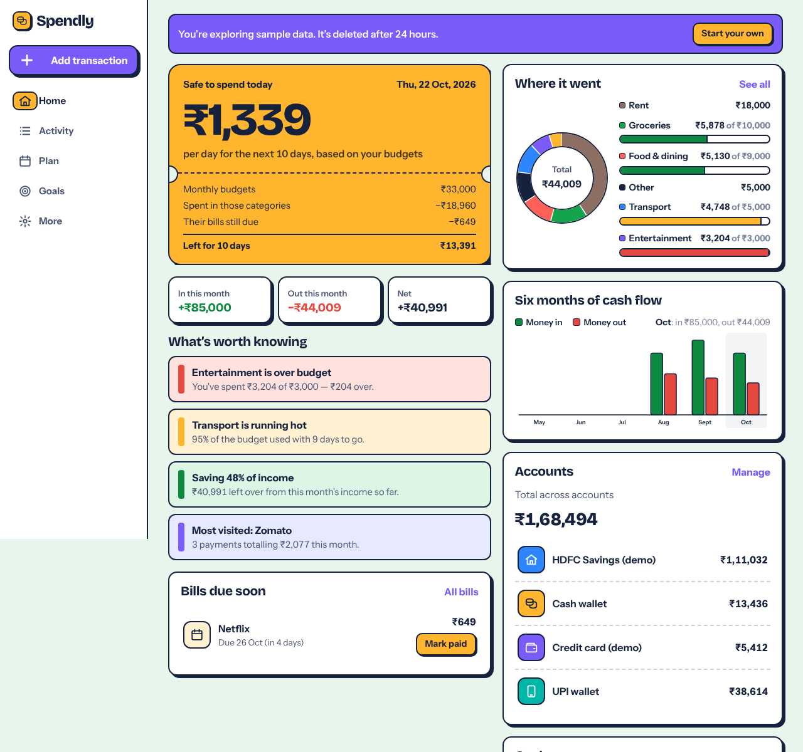
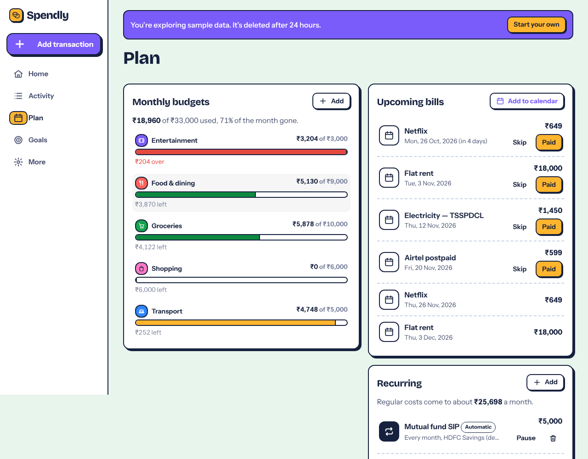
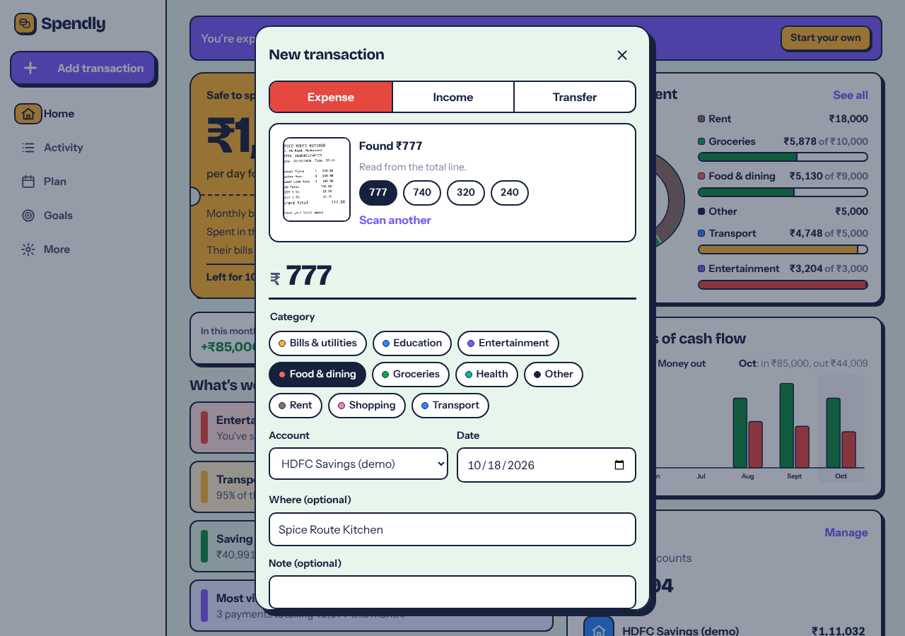
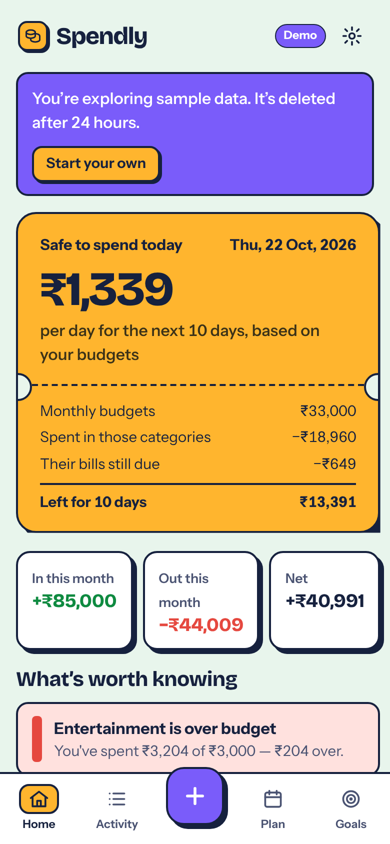

# Spendly

**Know what you can spend today.** Spendly is a playful, privacy-first personal finance companion. You log money across all your accounts (or scan a receipt), and it turns that into one honest daily number, with the arithmetic shown.



## The problem

Most people can't answer "how much can I safely spend today?" Bank apps show balances, not plans. Spreadsheets need discipline, and budgeting apps either want your bank login or bury the answer under charts. The result is a month that feels fine until the 24th.

**Who it's for:** students and early-career professionals, especially in India, who juggle cash, UPI wallets, a bank account and a credit card, and pay rent, phone and subscription bills on different dates.

## What makes it different

- **Safe to spend today, with the maths shown.** One daily figure from your budgets (or income), minus spending in those categories, minus bills still due, divided by the days left. Every line of the calculation is on the card, so you can trust it.
- **On-device receipt scanning.** Photograph a bill and Spendly reads the grand total (not the subtotal or GST lines), the date, the shop and a likely category. OCR runs in your browser with self-hosted Tesseract, so the photo never leaves your phone.
- **Recurring that actually recurs.** Salary and SIPs post themselves on schedule, including back-filling missed dates, idempotently. Bills wait for you to mark them paid (amounts vary), and they appear in your daily number until then.
- **Bills in your own calendar.** Export bills as an `.ics` feed with an alert N days before each due date, for Google, Apple or Outlook.

## Features

| Area | What works |
|---|---|
| Accounts | Cash, bank, card, UPI wallet, savings. Opening balances (negative for cards owed). Transfers between accounts. Archive accounts that have history. |
| Transactions | Expense, income, transfer. Categories, merchant, note, date. Edit and delete with **undo**. Search, filter by type, category, account and month, with keyset pagination. |
| Receipt scan | Tesseract.js OCR plus a tested parser: totals on the next line, OCR misreads (`l`→`1`, `O`→`0`), ignores phone numbers, GSTINs, dates, tax %, change and tendered lines, and offers alternative amounts. |
| Budgets | Monthly per category, with pace-aware warnings (85% used with 40% of the month left gets flagged). |
| Recurring and bills | Daily, weekly, monthly or yearly, every N periods, optional end date. Auto-post or bill mode, with mark paid, skip, pause and calendar export. |
| Savings goals | Target and deadline; add or withdraw money (you can't withdraw more than you've saved). The monthly amount needed is rounded up so following it never falls short. |
| Insights | Plain-language cards from real data: over budget, running hot, trends vs your own average (day-to-day spending only, so rent doesn't look like a spike), month-over-month pace, savings rate, most-visited merchant. |
| Charts | Hand-built animated SVG donut, 6-month cash-flow bars and goal rings, each with a text alternative. |
| Data | CSV export (with spreadsheet formula-injection guard), full JSON backup, and account deletion that removes everything. |
| Demo | One click opens a sandbox with about 3 months of clearly labelled sample data, deleted after 24 hours. |



| Receipt scan | Mobile |
|---|---|
|  |  |

## Architecture

```
Browser (React 19 client views, SWR cache, Motion)
  │   Tesseract.js OCR runs here; assets served from /tesseract on our own origin
  ▼
Next.js 15 App Router (Vercel serverless)
  ├─ app/app/*           server layout checks the session, client views render
  ├─ app/api/*           JSON route handlers: zod validation, ownership checks
  └─ lib/server/*        db, auth, recurrence engine, dashboard aggregation
  ▼
PostgreSQL (Neon in production; embedded PGlite for local dev and CI)
```

Pure, framework-free logic lives in `lib/` and is unit-tested directly:
`recurrence.ts`, `receipt.ts`, `insights.ts`, `money.ts`, `dates.ts`, `exporters.ts`.

## Technical decisions

- **Money is integer minor units** (`BIGINT` paise) end to end, so there are no floating-point drift bugs. Postgres `SUM(bigint)` returns NUMERIC, so both drivers parse it back to numbers.
- **Recurrence is computed from the start date, never the previous occurrence.** Occurrence *n* is `start + n × interval`, so a rule starting Jan 31 gives Feb 28, Mar 31, Apr 30 with no drift. Rules store `next_index`; a unique index on `(recurring_id, occurrence_index)` plus a `SELECT … FOR UPDATE` makes auto-posting idempotent, even when the dashboard and activity pages load at the same time.
- **Safe-to-spend in budget mode only counts budgeted categories.** An early version subtracted all spending (rent included) from the budget pool and showed ₹0. Browser review caught it, and the fix has a regression test.
- **Security:** bcrypt password hashes, and session ids stored *hashed* (SHA-256) so a leaked table can't be replayed. Sessions use http-only `SameSite=Lax` cookies. Every client-supplied id is checked against the signed-in user. Same-origin checks block cross-site writes. Login and sign-up are rate-limited in the database, so limits hold across serverless instances. A constant-time dummy hash stops account enumeration by timing. Security headers are set.
- **One database driver interface, two engines.** Real Postgres via `pg` in production, embedded PGlite locally and in CI, so tests run against real SQL with zero setup. Tables are prefixed `sp_` so Spendly can share a free database safely.
- **OCR is self-hosted** (engine and English data copied to `public/` at build time). This avoids a third-party CDN, works on restricted networks and keeps photos private.
- **Design:** neo-brutalist "pocket ledger" system with 2px ink outlines, hard shadows that press in on tap and flat colour. Spend and earn are always marked with − and + as well as colour. Motion respects `prefers-reduced-motion`. There's one orchestrated moment: the ticket prints in and the number counts up.

## Testing

| Layer | Command | Covers |
|---|---|---|
| Unit (18) | `npm test` | recurrence edge cases (month-end, leap day, end dates, caps), receipt parsing on 3 realistic receipts, money parsing and formatting, safe-to-spend and goal maths, insight rules, CSV and ICS output |
| API end-to-end (20) | `npm run test:e2e` | sign-up, login and rate limits, CSRF, validation, balances, pagination, budgets, idempotent recurring, bills, goals, dashboard maths consistency, exports, **cross-user isolation**, demo, account deletion |
| Browser journeys (10) | `python tests/ui_smoke.py` | real UI sign-up, add, edit and search, **real OCR on a receipt image**, budget, bill, goal, CSV download, keyboard (Esc and focus trap), mobile layout, no page errors |

GitHub Actions runs all three on every push (`.github/workflows/ci.yml`).

## Run locally

```bash
npm install
npm run dev            # http://localhost:3000, uses embedded PGlite in ./.pglite, no setup
```

Production needs one environment variable, `DATABASE_URL` (any Postgres; Neon's free tier works).

```bash
npm run build && npm start      # then, in another terminal:
npm run test:e2e
pip install playwright && python -m playwright install chromium && python tests/ui_smoke.py
```

## Honest limits

- No bank connections, by design: Spendly never asks for bank credentials and never moves money.
- Currency is a display setting; it doesn't convert existing amounts.
- OCR is tuned for printed English receipts; handwritten bills will need manual entry, and the form makes that easy.

---
Built by [kammatimanojsai-cmd](https://github.com/kammatimanojsai-cmd).
